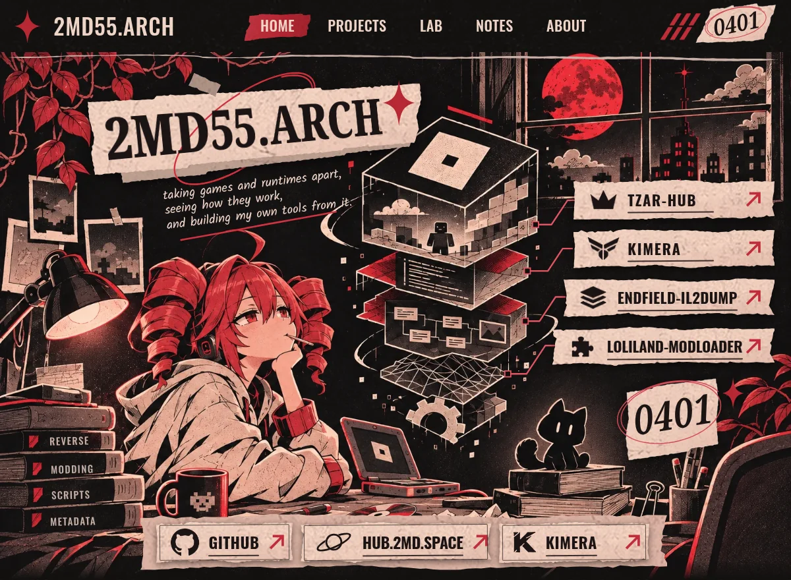
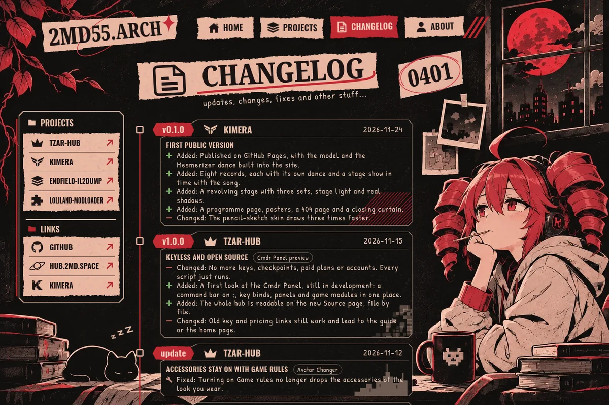
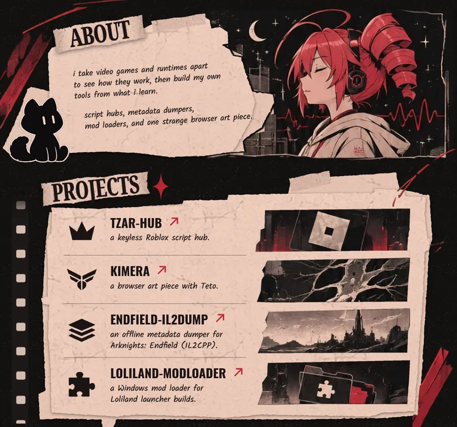

<div align="center">

# 2MD55.ARCH

**taking games and runtimes apart, seeing how they work, and building my own tools from it.**

[](https://2md.space)
[](#how-it-works)
[](#run-it)
[](LICENSE)

[Website](https://2md.space) · [Changelog](https://2md.space/changelog.html) · [Projects](#projects-on-the-site)



</div>

---

The source of **[2md.space](https://2md.space)**: a portfolio that looks like a desk covered in torn paper, tape and red ink. Three static pages in plain HTML, CSS and JavaScript, with no framework, no dependencies and no build step.

## Contents

- [What's inside](#whats-inside)
- [Run it](#run-it)
- [Repository layout](#repository-layout)
- [Update the changelog](#update-the-changelog)
- [How it works](#how-it-works)
- [Tools](#tools)
- [Deployment](#deployment)
- [Projects on the site](#projects-on-the-site)
- [License](#license)
- [Credits](#credits)

## What's inside

| Page | File | What it is |
| --- | --- | --- |
| **Home** | `index.html` | Loading screen, hero, About, Projects, Lab, Gallery with a lightbox, Notes (the three latest changelog entries) and a footer. |
| **Changelog** | `changelog.html` | What changed in each project, newest first. The list is generated from `data/changelog.json`. |
| **404** | `404.html` | The not-found page. |

<div align="center">

</div>

## Run it

There is nothing to install or build. Serve the folder with any static server:

```bash
python3 -m http.server 5173
```

Then open <http://localhost:5173>.

## Repository layout

```
index.html, changelog.html, 404.html   the pages
css/
  base.css        tokens, reset, page texture
  shapes.css      torn-paper outlines as SVG masks (generated)
  ui.css          shared pieces: icons, paper buttons, stamps, tags
  reveal.css      entrance animations for every section
  *.css           one file per section or page
js/
  loader.js       the loading screen
  main.js         menu, scroll animations, sticky header, lightbox
data/
  changelog.json  the releases shown on the changelog page
assets/
  img/            illustrations and photos used by the pages
  tex/            paper, ink and background textures
  icons/          icon masks, tinted with CSS
  source/         the design mockups and asset sheets the pages were built from
tools/            scripts that generate shapes, textures, art and the changelog
```

## Update the changelog

1. Add an entry at the top of `releases` in `data/changelog.json`:

   ```json
   {
     "project": "tzar-hub", "version": "v1.1.0", "date": "2026-12-01", "title": "Something new",
     "items": [
       ["added", "What was added."],
       ["fixed", "What was fixed."]
     ]
   }
   ```

   Item kinds are `added`, `fixed`, `changed` and `removed`. `title`, `label` (a small tag after the title) and `short` (a shorter title for the home page) are optional.

2. Rebuild the pages:

   ```bash
   node tools/build-changelog.mjs
   ```

   This rewrites the list in `changelog.html` and the three rows of the Notes section in `index.html`.

## How it works



- **Sized like the mockups.** Every measurement is a fraction of the page width (`--u` is the width divided by 667, through container query units), so the composition keeps its proportions from a phone to a desktop. The home page has two layouts that switch at 820px.
- **Torn paper is real HTML.** The ragged outlines are SVG masks in `css/shapes.css`, laid over raster paper textures. The notes, lists and headings on the paper are live text: they can be selected, translated and read by a screen reader.
- **The loading screen shows real progress.** It follows the fonts and images of the page as they arrive and lifts when they are in. Its lettering and digits are drawn as SVG strokes, so it needs no font itself.
- **Sections come alive on scroll.** Each one plays its entrance once, when it comes into view: sheets drop, tape sticks, pen lines draw, handwriting appears from left to right. The choreography is in `css/reveal.css`.
- **Small things.** The header stays on screen and its red tag follows the section you are reading. Gallery photos open in a native `<dialog>` with keyboard and swipe navigation. Only text can be selected, never the pictures.
- **It degrades gently.** With `prefers-reduced-motion` the animations are off. Without JavaScript the page simply shows, with no loading screen.

<br clear="right" />

## Tools

None of these are needed to run the site. They regenerate its assets.

| Script | What it does | Needs |
| --- | --- | --- |
| `tools/build-changelog.mjs` | Renders `data/changelog.json` into `changelog.html` and the Notes rows of `index.html` | Node |
| `tools/build-shapes.mjs` | Generates the torn-paper outlines: `css/shapes.css` and a few inline SVG paths | Node |
| `tools/build-textures.sh`, `tools/build-icons.sh` | Cut the textures and icon masks out of the asset sheets | ImageMagick 7 |
| `tools/build-*-art.py` | Cut the illustrations of each section out of the mockups and upscale them | Python 3, Pillow, NumPy; optionally `waifu2x-ncnn-vulkan` |
| `tools/check-animations.mjs`, `tools/screenshot-finished.mjs`, `tools/measure.mjs` | Open a page in headless Chrome on the real clock to check the animations, take a screenshot of the finished page or read element sizes | Node 22+, Google Chrome, the local server on port 5173 |

## Deployment

The site is hosted on Vercel as plain static files. The Vercel project is linked to this repository, so every push to `main` goes live at [2md.space](https://2md.space). There are no build settings.

## Projects on the site

- [tzar-hub](https://github.com/2md55nmxkw-arch/tzar-hub): a free, keyless and open-source Roblox script hub ([hub.2md.space](https://hub.2md.space)).
- [kimera](https://github.com/2md55nmxkw-arch/kimera): a browser art piece with Kasane Teto ([open it](https://2md55nmxkw-arch.github.io/kimera/)).
- [endfield-il2dump](https://github.com/2md55nmxkw-arch/endfield-il2dump): an offline IL2CPP metadata dumper for Unity x64.
- [Loliland-ModLoader](https://github.com/2md55nmxkw-arch/Loliland-ModLoader): a Windows mod loader for Loliland launcher builds.

## License

The code and documentation in this repository are released under the **[MIT License](LICENSE)**.

The 2MD55.ARCH name and logo, the Kasane Teto artwork and the third-party fonts and icon listed below are not covered by MIT.

## Credits

- 重音テト (Kasane Teto) © 線/小山乃舞世/TWINDRILL. The artwork on this site is non-commercial fan art, not official art.
- Type: [Noto Serif](https://fonts.google.com/noto/specimen/Noto+Serif), [Oswald](https://fonts.google.com/specimen/Oswald), [Kalam](https://fonts.google.com/specimen/Kalam) and [Patrick Hand](https://fonts.google.com/specimen/Patrick+Hand), served by Google Fonts under the SIL Open Font License.
- The wrench icon on the changelog page is from [Material Design Icons](https://github.com/google/material-design-icons) (Apache License 2.0).
